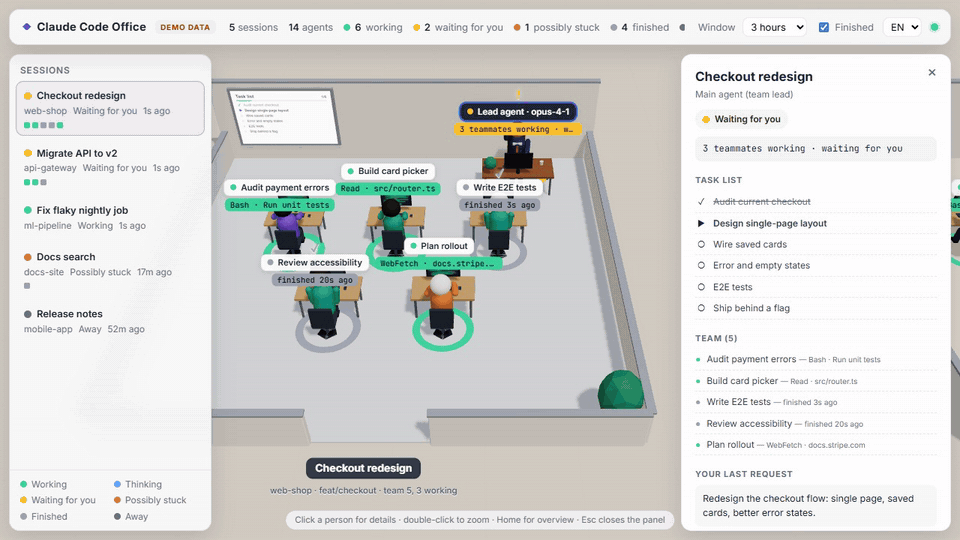
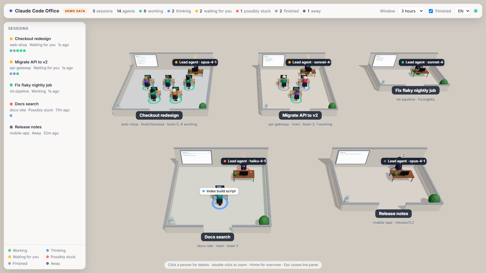

<div align="center">

# Claude Code Office

**See your Claude Code agents at work: a live 3D office for your sessions and subagents.**

Every session is a room. The main agent sits at the lead's desk, and each subagent gets its own desk, monitor and status light.
You can see who is typing, who is thinking, who is waiting for you and who got stuck, without digging through terminals.

[](https://github.com/bugraskl/claude-code-office/actions/workflows/ci.yml)
[](https://github.com/bugraskl/claude-code-office/blob/main/LICENSE)
[](https://www.npmjs.com/package/claude-code-office)


**English** · [Türkçe](https://github.com/bugraskl/claude-code-office/blob/main/README.tr.md)



</div>

## Quick start

You need Node.js 18 or newer and at least one Claude Code session on this machine.

```bash
npx claude-code-office
```

The office opens at **http://127.0.0.1:4777**. It updates every two seconds, so leave it open on a second screen.

Want to look around before running it on your own sessions?

```bash
npx claude-code-office --demo
```

## What you see

| | Status | What the agent is doing |
|---|---|---|
| 🟢 | **Working** | A tool call is running. Hands on the keyboard, code scrolling on the monitor. The label shows the tool and its target, such as `Bash · Run unit tests`. |
| 🔵 | **Thinking** | The model is writing its next step. Hand on chin, thought bubble. |
| 🟡 | **Waiting for you** | The main agent finished its turn and is waving at you. If its team is still busy, the label says so. |
| 🔴 | **Possibly stuck** | A tool call has not returned for 15 minutes. It may be waiting for a permission prompt, or it may be a very long command. |
| ⚪ | **Finished** | A subagent is done and leans back. It stays at its desk for 20 minutes, then leaves. |
| ⚫ | **Away** | No activity for 30 minutes. Head down on the desk. |

- **New subagents walk in through the door** and sit at a free desk. When there are more agents, the room grows to fit them.
- **The whiteboard** shows the session's task list (from `TodoWrite` or the desktop app's plan) with a progress bar.
- **Click anyone** to open their file: the assignment they were given, the last thing they wrote, their last ten tool calls (failures in red), output tokens, context size, model, folder and branch.
- **The sidebar** lists every session with a coloured strip for its team. Click a session to fly the camera to its room.
- Workflow agents are shown with their phase, and background agents are marked.



## Options

```text
npx claude-code-office [options]

  -p, --port <n>      Port to listen on (default 4777)
      --host <addr>   Interface to bind (default 127.0.0.1)
  -d, --dir <path>    Claude Code projects folder
                      (default $CLAUDE_CONFIG_DIR/projects or ~/.claude/projects)
      --hide <regex>  Hide project folders matching this pattern (repeatable)
      --demo          Show a simulated office instead of your real sessions
      --no-open       Don't open the browser
```

In the page you can pick the time window (1 hour to 2 days), hide finished agents, and switch the language (English and Turkish). Shortcuts: double-click to zoom into a room, `Home` for the overview, `Esc` to close the panel.

### Install it instead of using npx

```bash
npm install -g claude-code-office
claude-code-office
```

Or run it from a clone:

```bash
git clone https://github.com/bugraskl/claude-code-office.git
cd claude-code-office
npm start            # or: npm run demo
```

### Watching a remote machine

The server only listens on `127.0.0.1` by default. To watch agents that run on a server, use an SSH tunnel:

```bash
ssh -L 4777:127.0.0.1:4777 you@build-box 'npx claude-code-office --no-open'
```

Then open http://127.0.0.1:4777 on your laptop. `--host 0.0.0.0` also works on a trusted network, but anyone who can reach the port can read your prompts and tool calls.

## How it works

Claude Code writes every session to a JSON Lines transcript:

```text
~/.claude/projects/<project>/<session-id>.jsonl                        main agent
~/.claude/projects/<project>/<session-id>/subagents/agent-<id>.jsonl   subagents
~/.claude/projects/<project>/<session-id>/subagents/agent-<id>.meta.json
```

A small Node server scans this folder, reads each file **incrementally** from the byte where it stopped last time, and works out a status from the latest events:

- a `tool_use` without a matching `tool_result` means the agent is **working**,
- `end_turn` or a stop hook means the turn is over, so the main agent is **waiting** and a subagent is **finished**,
- `.meta.json` gives each subagent its name, type, workflow phase and finished flag,
- `custom-title` gives the room its name, and `TodoWrite` / `update_plan` calls rebuild the task list.

The browser polls `/api/state` and renders the office with [three.js](https://threejs.org). There is no build step, and the server has no dependencies.

## Privacy

- It **only reads** transcript files and never writes, sends or uploads anything.
- It binds to `127.0.0.1` unless you choose another host.
- The page loads three.js and fonts from public CDNs (jsdelivr, Google Fonts). Your session data never leaves the local server.

## FAQ

**Does it work with the CLI, the desktop app and the IDE extensions?**
Yes. They all write the same transcripts. Task lists come from `TodoWrite` in the CLI and from the plan panel in the desktop app.

**Windows, macOS, Linux?**
All three. CI runs on each of them with Node 18, 20 and 22.

**Why can't it show "waiting for permission"?**
Permission prompts are not written to the transcript. A tool call that hangs for 15 minutes shows up as *possibly stuck* instead. You can change the thresholds at the top of [`src/transcripts.js`](https://github.com/bugraskl/claude-code-office/blob/main/src/transcripts.js).

**My transcripts are somewhere else.**
Use `--dir /path/to/projects` or set `CLAUDE_CONFIG_DIR`.

## Contributing

Issues and pull requests are welcome. Run the tests with `npm test`. Use `npm run demo` to work on the scene without real sessions. UI strings are in [`public/i18n.js`](https://github.com/bugraskl/claude-code-office/blob/main/public/i18n.js): copy the `en` block to add a language.

## License

[MIT](https://github.com/bugraskl/claude-code-office/blob/main/LICENSE). This is a community project and is not affiliated with or endorsed by Anthropic. "Claude" and "Claude Code" are trademarks of Anthropic.
