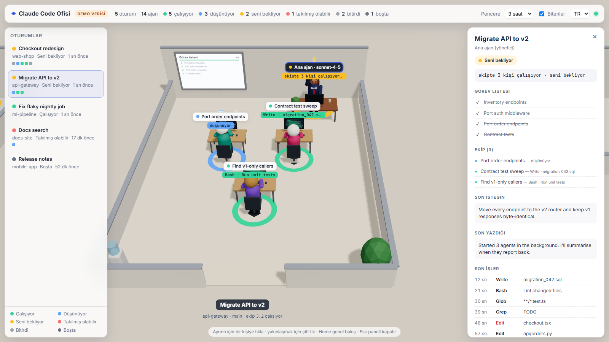

<div align="center">

# Claude Code Office

**Claude Code ajanlarını çalışırken gör: oturumların ve alt ajanların için canlı bir 3B ofis.**

Her oturum bir oda. Ana ajan yönetici masasında oturuyor, her alt ajanın kendi masası, ekranı ve durum ışığı var.
Kim yazıyor, kim düşünüyor, kim seni bekliyor, kim takıldı; terminalleri karıştırmadan tek bakışta görürsün.

[](https://github.com/bugraskl/claude-code-office/actions/workflows/ci.yml)
[](LICENSE)


[English](README.md) · **Türkçe**



</div>

## Hızlı başlangıç

Node.js 18 veya üstü ve bu bilgisayarda en az bir Claude Code oturumu yeterli.

```bash
npx github:bugraskl/claude-code-office
```

Ofis **http://127.0.0.1:4777** adresinde açılır ve iki saniyede bir güncellenir. İkinci ekranda açık bırakabilirsin.

Önce kendi oturumların olmadan denemek istersen:

```bash
npx github:bugraskl/claude-code-office --demo
```

Arayüz dili tarayıcı diline göre seçilir; sağ üstten EN / TR arasında geçebilirsin.

## Ne görürsün

| | Durum | Ajan ne yapıyor |
|---|---|---|
| 🟢 | **Çalışıyor** | Bir araç çalışıyor. Eller klavyede, ekranda kod akıyor. Etikette araç ve hedefi yazar, örneğin `Bash · Run unit tests`. |
| 🔵 | **Düşünüyor** | Model sonraki adımını yazıyor. Eli çenesinde, üstünde düşünce balonu. |
| 🟡 | **Seni bekliyor** | Ana ajan turunu bitirdi ve sana el sallıyor. Ekibi hâlâ çalışıyorsa etikette bu da yazar. |
| 🔴 | **Takılmış olabilir** | Bir araç 15 dakikadır sonuç döndürmedi. İzin bekliyor olabilir ya da çok uzun bir komuttur. |
| ⚪ | **Bitirdi** | Alt ajan işini bitirdi ve arkasına yaslandı. 20 dakika masasında kalır, sonra ayrılır. |
| ⚫ | **Boşta** | 30 dakikadır hareket yok. Başı masada uyuyor. |

- **Yeni alt ajanlar kapıdan girer** ve boş bir masaya oturur. Ajan sayısı arttıkça oda da büyür.
- **Beyaz tahtada** oturumun görev listesi ilerleme çubuğuyla yazar. Liste CLI'daki `TodoWrite`'tan ya da masaüstü uygulamasının planından gelir.
- **Bir kişiye tıklayınca** ayrıntıları açılır: verilen görev, son yazdığı metin, son on aracı (hatalılar kırmızı), üretilen token, bağlam boyu, model, klasör ve dal.
- **Soldaki liste** her oturumu ekibinin renk şeridiyle gösterir. Bir oturuma tıklayınca kamera o odaya gider.

## Seçenekler

```text
  -p, --port <n>      Port (varsayılan 4777)
      --host <adres>  Dinlenecek arayüz (varsayılan 127.0.0.1)
  -d, --dir <yol>     Claude Code projects klasörü
      --hide <regex>  Bu desene uyan proje klasörlerini gizle (tekrarlanabilir)
      --demo          Gerçek oturumlar yerine örnek bir ofis göster
      --no-open       Tarayıcıyı açma
```

Uzak bir makinedeki ajanları izlemek için SSH tüneli kullanabilirsin:

```bash
ssh -L 4777:127.0.0.1:4777 sen@sunucu 'npx github:bugraskl/claude-code-office --no-open'
```

## Nasıl çalışır, gizlilik

Claude Code her oturumu `~/.claude/projects/` altında JSON Lines dosyalarına yazar. Küçük bir Node sunucusu bu dosyaları yalnız okur. Her dosyada en son kaldığı bayttan devam eder ve durumu son olaylardan çıkarır. Hiçbir şeyi yazmaz, göndermez, yüklemez. Varsayılan olarak yalnız `127.0.0.1`'e bağlanır. Ayrıntılar [İngilizce README](README.md#how-it-works)'de.

## Lisans

[MIT](LICENSE). Bu bir topluluk projesidir; Anthropic ile bağlantılı değildir ve Anthropic tarafından onaylanmamıştır.
